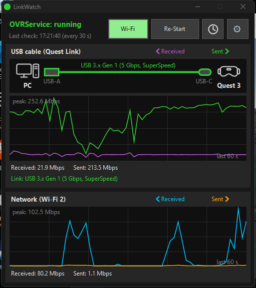
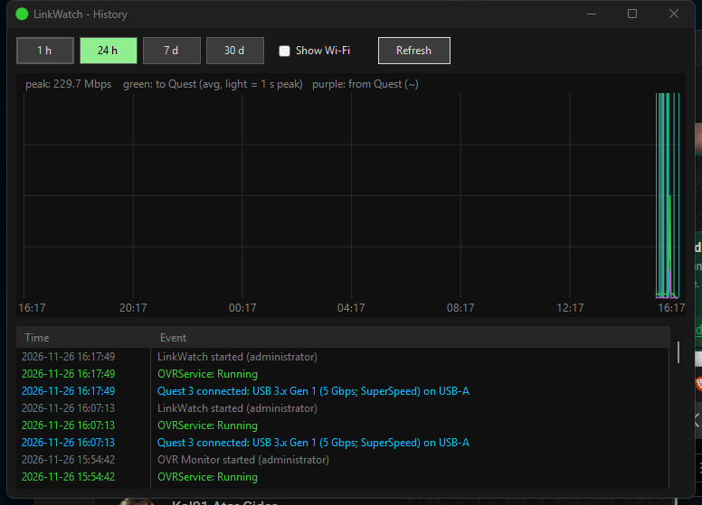
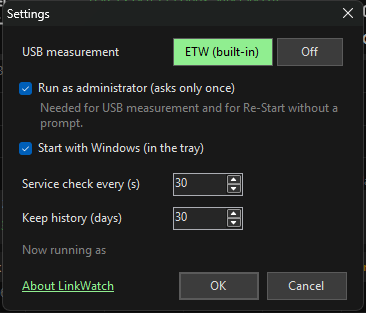

<p align="center">
  <a href="https://revolando.com"></a>
</p>

<h1 align="center">LinkWatch</h1>

<p align="center">
  <b>Is your Quest Link cable really giving you USB 3? Find out in one glance.</b><br>
  The Quest Link diagnostic tool for Windows: cable speed, real data rate, history, and a one-click service fix.<br>
  One 70&nbsp;KB exe. No installer, no drivers, no runtime, no third-party code.
</p>

<p align="center">
  <a href="../../releases/latest"></a>
  
  <a href="LICENSE"></a>
  
  
</p>

<p align="center">
  
</p>

---

## What LinkWatch does that tweak tools don't

Most Quest Link utilities help you **change settings**: bitrate, super sampling, profiles. LinkWatch answers a different question: **is the connection itself healthy?** It does not guess from settings, it reads what Windows actually negotiated and what actually goes through the cable.

<table>
<tr>
<td width="50%" valign="top">

### 🔌 Catches the silent USB 2.0 fallback
A Quest 3 on a "USB 3" cable can quietly run at **480 Mbps** for months. LinkWatch reads the negotiated speed straight from the USB hub driver and warns you when the headset *could* do USB 3 but the link did not: **check cable or port**. Nothing else on the tray tells you this.

</td>
<td width="50%" valign="top">

### 🖥️➖🥽 Draws your actual cable
PC on one side, headset on the other: the PC-side connector (**USB-A or USB-C**), any **hub** in the path, and the link speed, colour-coded. Plug it the other way round, move it to another port, and watch the picture change within 5 seconds.

</td>
</tr>
<tr>
<td valign="top">

### 📈 Measures real traffic, not settings
A bitrate slider tells you what you asked for. LinkWatch shows **what actually flows**: bytes per second to the headset (exact) and back (approximate), from Windows' own USB 3 driver events. ~200 Mbps in a live VR session, ~4 Mbps when Link sits idle.

</td>
<td valign="top">

### 🕒 Remembers what happened
Link dropped during last night's session? The **history** view keeps minute-by-minute rates and every event: service stopped, headset unplugged, **speed dropped from USB 3 to USB 2**, restarts. Up to a year if you want; 30 days by default.

</td>
</tr>
<tr>
<td valign="top">

### 🪶 Tiny and dependency-free
**70 KB**, a single exe. No installer, no .NET runtime download, no ADB, no kernel driver, no telemetry. Built with the compiler that ships inside Windows; you can rebuild it in seconds.

</td>
<td valign="top">

### 🛟 Fixes the classic Link hang
When OVRService stops or Link refuses to connect, the tray turns red and **one click** restarts the service, with no admin prompt after the one-time setup.

</td>
</tr>
</table>

Use it next to your favourite tweak tool: they change the settings, LinkWatch tells you whether the pipe underneath can deliver them.

## Why this exists

It started with one annoying line.

Every so often **Quest Link stopped working**: the headset would not connect, Unreal's *VR Preview* button turned grey, and the fix was always the same, open an admin terminal and type

```powershell
Restart-Service OVRService
```

So the first version was a small script that pinged the service and offered a one-click restart.

Then we wanted to *see* what was going through the cable. And that is where it got interesting: the first real measurement showed that the headset, which supports 5 Gbps USB 3, had been running at **USB 2.0 (480 Mbps)** all along. The PC ports were fine, the headset was fine; the "USB 3" cable was not making its SuperSpeed contacts. Swapping ports did nothing, a new cable helped, and a four-plug test showed something nobody tells you: **with that cable, plugging the USB-C end one way gave USB 3, the other way USB 2**, every single time.

That turned a quick script into a proper tool. The first data-rate version used a third-party USB capture driver. We replaced it with Windows' own **Event Tracing for Windows (ETW)** and compared the two side by side during a live VR session: the PC → Quest stream matched to within about 0.1 %. Nothing else to install, nothing running in the kernel that Windows did not already ship.

What we measured on the way, for the curious:

| | |
|---|---|
| Link idle (headset in the Link home) | ~4 Mbps to the headset |
| Unreal VR Preview running | **~200 Mbps** to the headset, ~30 Mbps back |
| Share of a 5 Gbps USB 3 link | ~5 % |
| Share of the same stream on USB 2.0 | ~half of the 480 Mbps bus |

If your Link image is blurry, stutters or drops, check the cable before anything else. LinkWatch shows you in one glance.

## Features

- **OVRService watchdog**: checks the Quest Link service on an interval you choose, tray icon turns red and a notification pops up if it stops.
- **One-click Re-Start**: restarts OVRService (with a warning, because it drops the live Link connection).
- **Cable diagram**: PC on the left, headset on the right, the cable in between, coloured by speed. Shows the PC-side connector (USB-A / USB-C), any hub in between, and the negotiated speed: USB 2.0, USB 3 Gen 1 (5 Gbps), Gen 2 (10 Gbps). If the headset could do USB 3 but the link fell back to USB 2, it tells you to check the cable or port.
- **Real USB data rate**: live graph of bytes going **to** the Quest (exact) and **from** the Quest (approximate), read from Windows' USB 3 driver events.
- **Wi-Fi graph (optional)**: received / sent on your network adapter, useful for Air Link.
- **History**: one-minute averages and 1-second peaks, plus an event log (service stopped / started, headset plugged / unplugged, link speed changed, restarts), shown on a 1 h / 24 h / 7 d / 30 d graph with event markers. Kept for 30 days by default, adjustable.
- **Admin mode without nagging**: asks for administrator rights **once**, then starts elevated from a Windows scheduled task, at logon and from the exe, with no further prompts.
- **Small and self-contained**: a single exe of about 70 KB, built with the C# compiler that ships with Windows. No installer, no runtime to download, no telemetry.

<p align="center">
  
</p>

## Download and run

1. Get `LinkWatch.exe` from the [latest release](../../releases/latest).
2. Put it anywhere, for example `C:\Tools\LinkWatch\`, and run it.
3. Click the **gear** icon, tick **Run as administrator (asks only once)** and press OK. Approve the Windows prompt.

   
   This is needed for the USB data rate (ETW needs admin) and for restarting the service without a prompt.
4. Optional: keep **Start with Windows** ticked so it lives in your tray.

Closing the window hides it to the tray. Use **Exit** in the tray menu to quit.

> Windows SmartScreen may warn about an unknown publisher, because the exe is not code-signed. You can check the source and build it yourself in a few seconds, see below.

## Build it yourself

No Visual Studio needed. Windows already contains the .NET Framework 4 C# compiler.

```powershell
git clone https://github.com/Revolando-Ltd/linkwatch.git
cd linkwatch
powershell -ExecutionPolicy Bypass -File .\build.ps1
```

`build.ps1` draws the icon, then compiles `src\*.cs` into `LinkWatch.exe` with `csc.exe` from `%WINDIR%\Microsoft.NET\Framework64\v4.0.30319`.

## How it works

| What | How (all built into Windows) |
|---|---|
| Service state and restart | `System.ServiceProcess.ServiceController` |
| Finding the headset | Configuration Manager API (`cfgmgr32`), USB vendor ID `2833` |
| Negotiated speed, port type | USB hub IOCTLs: `GET_NODE_CONNECTION_INFORMATION_EX(_V2)`, `GET_PORT_CONNECTOR_PROPERTIES` |
| Data rate | Real-time ETW session on `Microsoft-Windows-USB-USBXHCI`, event 41 (transfer), size read with TDH |
| Wi-Fi rate | `System.Net.NetworkInformation` interface counters |
| Elevation without prompts | A per-user scheduled task with *Run with highest privileges* |
| Settings and history | `%APPDATA%\LinkWatch\` (`settings.json`, `history\*.csv`) |

**About the "Received" number:** for transfers coming *into* the PC, Windows logs the size of the buffer that was offered, not the bytes that actually arrived. Under load it reads roughly 10-15 % high, at idle much more, so it is shown with a `~`. The *Sent* direction (PC to headset, the video stream) is exact.

## Uninstall

Open the gear menu, untick **Run as administrator** and **Start with Windows** (this removes the scheduled task and the startup entry), exit from the tray, delete the exe. To remove the history as well, delete `%APPDATA%\LinkWatch`.

## Contributing

Issues and pull requests are welcome. Ideas that would fit well: support for other PC VR headsets, Air Link specific stats, a dark/light theme switch, translations.

LinkWatch is **free for personal and other noncommercial use**. You can read the code, change it and share your changes for noncommercial purposes. Two things go with every copy, original or modified: the [LICENSE](LICENSE) and the [NOTICE](NOTICE) (which credits REVOLANDO LTD).
## Disclaimer

LinkWatch is provided **"as is", without warranty of any kind**, and you use it at your own risk. On first start it shows these terms and only runs after you accept them. It restarts the OVRService Windows service when you ask it to (which drops any live Link session), reads USB events through Windows' own ETW, and in administrator mode registers a scheduled task. It installs no drivers and sends no data anywhere. To the maximum extent permitted by law, REVOLANDO LTD and the authors are not liable for any damage or loss arising from its use. This is a **beta**: it has been tested on Windows 11 with a Meta Quest 3; please [open an issue](../../issues) if something behaves differently on your setup.

## License

Copyright 2026 **[REVOLANDO LTD](https://revolando.com)**, London.
Licensed under the [PolyForm Noncommercial License 1.0.0](LICENSE). See [NOTICE](NOTICE).

**Commercial use.** Selling LinkWatch, bundling it with a paid product or service, or using it for any other commercial purpose needs a commercial license. REVOLANDO LTD is the only party entitled to sell it; get in touch via [revolando.com](https://revolando.com).
LinkWatch is an independent project and is not affiliated with, endorsed by or sponsored by Meta Platforms, Inc. Meta, Meta Quest, Quest and Oculus are trademarks of Meta Platforms, Inc.

<p align="center">
  <a href="https://revolando.com"></a><br>
  <sub>Made by <a href="https://revolando.com">REVOLANDO</a>, Digital Dreamland</sub>
</p>
